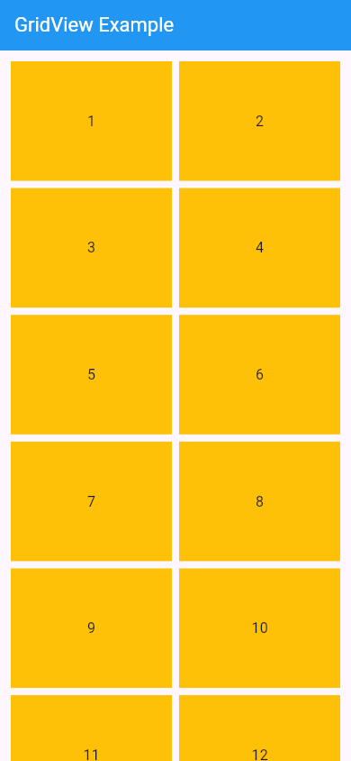

# Flutter GridView Widget Presentation on 12/October/2026

## 1. Project overview

This small Flutter project demonstrates the `GridView` widget with a simple
two-column grid of twelve numbered tiles. It shows how a grid can display a
collection of items in rows and columns and scroll when the content is longer
than the screen.

## 2. Presentation objectives

- Explain what `GridView` does.
- Run the numbered-tile demo.
- Describe three `GridView.count` properties and how their values affect the
  layout.

## 3. Widgets used

| Widget | Purpose |
| --- | --- |
| `MaterialApp` | Sets up the app and Material theme. |
| `Scaffold` | Provides the screen structure and app bar. |
| `AppBar` | Displays the “GridView Example” title. |
| `GridView.count` | Arranges the tiles in a scrollable grid. |
| `Container` | Provides each tile’s amber background and centered content. |
| `Text` | Displays each tile’s number. |

## 4. GridView properties

The demo uses the following three properties to configure its grid:

### A. `mainAxisSpacing`

- **Default:** `0` logical pixels.
- **Value in this demo:** `8` logical pixels.
- **Effect:** Adds vertical space between grid rows.
- **Why adjust it:** Increase the value when items in adjacent rows need more
  separation.

### B. `crossAxisSpacing`

- **Default:** `0` logical pixels.
- **Value in this demo:** `8` logical pixels.
- **Effect:** Adds horizontal space between grid columns.
- **Why adjust it:** Increase the value when items in neighboring columns look
  crowded.

### C. `childAspectRatio`

- **Default:** `1.0` (square tiles).
- **Value in this demo:** `1.35` (wider-than-tall tiles).
- **Effect:** Controls each tile’s width-to-height ratio.
- **Why adjust it:** Choose a ratio that gives each item suitable proportions
  for its content and screen layout.

## 5. Code organization

- `GridViewApp` sets up the app and opens the demo screen.
- `GridViewPage` builds the app bar and numbered grid.
- `GridView.count` creates twelve amber tiles, each with a centered number.

The implementation is in [`lib/main.dart`](lib/main.dart).

## 6. Expected output

The screen displays an app bar titled “GridView Example” and twelve amber
numbered tiles in two columns. Scroll the grid to view the remaining tiles on a
short screen.

## 7. How to run the project

### Prerequisites

- Flutter SDK installed.
- A connected device, emulator, or supported desktop target.

### Instructions

```sh
git clone https://github.com/BonaneNIYIGENA/gridview--WidgetPresentation.git
cd gridview--WidgetPresentation
flutter pub get
flutter run
```

## 8. Screenshot



## 9. Conclusion

`GridView` arranges content in rows and columns and supports scrolling when
needed. This example uses spacing and tile proportions to control how its
numbered items appear on screen.
